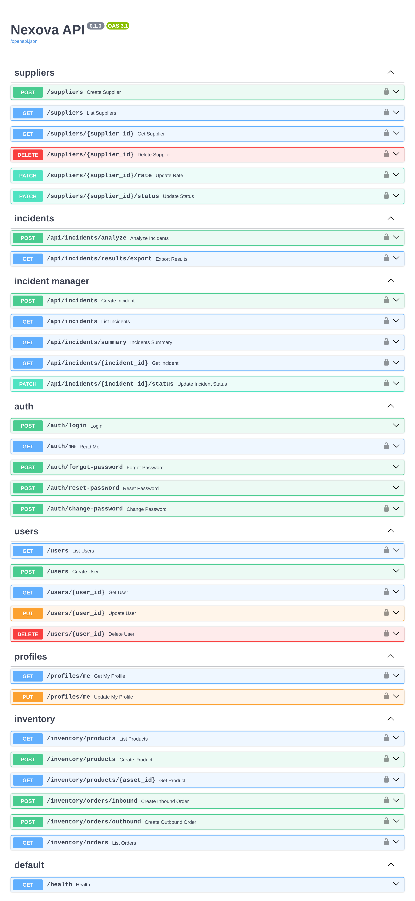

# Nexova — AI Engineering Company Project

Full-stack monorepo for **Nexova**, a fictional company I'm building milestone by milestone during the [4Geeks Academy AI Engineering programme](https://4geeksacademy.com/en/career-programs/ai-engineering). It brings together a centralised **FastAPI** backend, two **Next.js** frontends and the data scripts that feed them.

> **Where's the code?** Each milestone is developed in its own `feature/*` branch. The latest, [`feature/serialization-audit`](https://github.com/JesusMart007/ai-engineering-company-project-monorepo/tree/feature/serialization-audit), contains the complete project.


## What's inside

| Area | What it does | Stack |
|---|---|---|
| **Supplier directory** | CRUD for suppliers, plus status changes, rate updates and filters. Comes with an idempotent seeder. | FastAPI · Pydantic · TinyDB |
| **Authentication** | Registration, login, `/auth/me`, profiles, change password and password reset by email. Every business route is protected. | JWT (python-jose) · bcrypt · Resend |
| **Incident analyser** | Uploads a helpdesk CSV, then validates, aggregates and exports the results. | Python · FastAPI |
| **Incident manager** | A central incident log with a status workflow and summary metrics. 96 historical incidents are loaded from CSV. | FastAPI · TinyDB |
| **Inventory** | Assets with inbound and outbound orders, and stock calculated from movements. Uses foreign keys and an idempotent seed. | SQLModel ORM · PostgreSQL (Supabase) |
| **Backoffice** | An internal app for suppliers, incidents, inventory and accounts, with route guards and session checks. | Next.js · React · TypeScript · Jest |
| **Talent pipeline website** | A public candidate tracker with search, filters and notes. The home page is rendered on the server. | Next.js 16 · React 19 · Tailwind CSS 4 |

<details>
<summary><strong>API endpoints (Swagger UI)</strong></summary>



</details>

## Highlights

- **One centralised API** with a router for each domain (`/suppliers`, `/auth`, `/users`, `/profiles`, `/api/incidents`, `/inventory`), documented automatically at `/docs`.
- **Two storage layers on purpose:** lightweight TinyDB for users and the directory, and relational PostgreSQL through the SQLModel ORM for inventory.
- **Consistent error handling and serialisation contracts**, covered by dedicated tests (see [`docs/error-handling-audit.md`](https://github.com/JesusMart007/ai-engineering-company-project-monorepo/blob/feature/serialization-audit/docs/error-handling-audit.md) and [`docs/serialization-audit.md`](https://github.com/JesusMart007/ai-engineering-company-project-monorepo/blob/feature/serialization-audit/docs/serialization-audit.md)).
- **Performance and accessibility audit** with Lighthouse, measured before and after each fix:
  - mobile LCP on the home page: **2.2 s → 0.7 s**
  - Accessibility: **86–96 → 100** on every audited page
  - desktop CLS on `/suppliers`: **0.118 → 0.008**

  Full results: [`REPORT.md`](https://github.com/JesusMart007/ai-engineering-company-project-monorepo/blob/feature/serialization-audit/REPORT.md).
- **Everything runs with one command** using Docker Compose.


## Run locally

```bash
git clone https://github.com/JesusMart007/ai-engineering-company-project-monorepo.git
cd ai-engineering-company-project-monorepo
git checkout feature/serialization-audit
cp .env.example .env        # fill in SECRET_KEY, DATABASE_URL, etc.
docker compose up --build
```

- API docs: http://localhost:8000/docs
- Website: http://localhost:3000
- Backoffice: http://localhost:3001

To run the API on its own with [uv](https://docs.astral.sh/uv/):

```bash
cd services/api
uv sync
uv run seed                                 # 15 suppliers
uv run uvicorn main:app --reload --port 8000
uv run pytest                               # 217 tests
```

More detail in [`services/api/README.md`](https://github.com/JesusMart007/ai-engineering-company-project-monorepo/blob/feature/serialization-audit/services/api/README.md).

## Repository layout

```
services/api/                 FastAPI backend (routes/, models, services, tests/)
uis/backoffice/               Internal Next.js backoffice
uis/talent-pipeline-tracker/  Public Next.js website
scripts/                      CSV analyser and database seeders
packages/shared/              Shared types
docs/                         Architecture notes and audits
audit/                        Lighthouse evidence (before / after)
docker-compose.yml            Local orchestration
```

## What I learned

- Designing a REST API with clear domain boundaries, validation and consistent error responses
- Securing endpoints with JWT, hashing passwords and building a full password-reset flow
- Modelling relational data with an ORM and connecting to a managed PostgreSQL database
- Writing tests that never touch real data (temporary databases and fixtures)
- Measuring performance and accessibility, finding the root cause and proving each fix with numbers

## About

Built by **Jesús Martínez**, who is moving from logistics leadership into AI engineering. Based in Manchester, UK. [LinkedIn](https://www.linkedin.com/in/jesus-martinez-ai)

The base template comes from the [4Geeks Academy](https://github.com/4geeksacademy) AI Engineering programme. The original folder guide is in [`README.es.md`](README.es.md).
